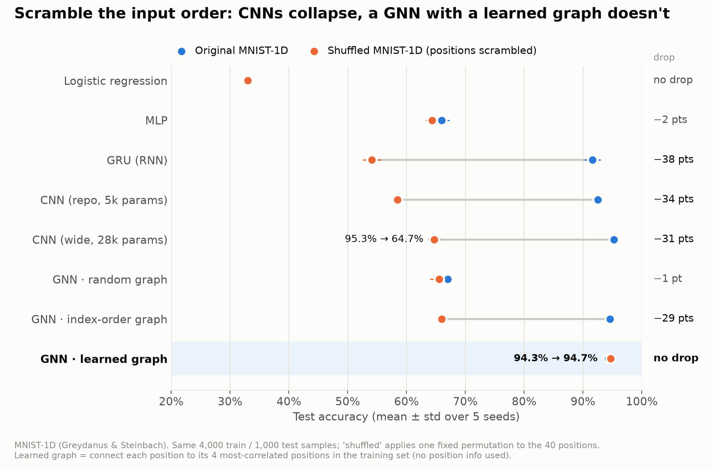
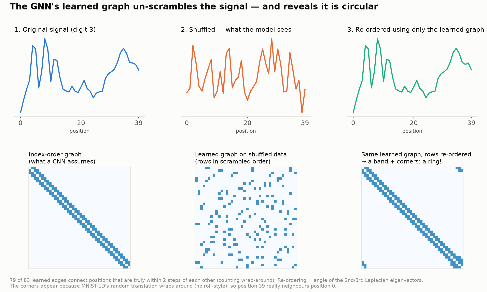

# Do Neural Networks Need the Input Order? A GNN on Shuffled MNIST-1D

[MNIST-1D](https://github.com/greydanus/mnist1d) benchmarks logistic regression, MLPs, CNNs and GRUs, but not
graph neural networks. This project adds GNNs and uses them to examine the most interesting row of the
original benchmark: **shuffled MNIST-1D**, where the 40 positions of every signal are scrambled with one fixed permutation.



## Results (test accuracy, mean ± std over 5 seeds)

| Model | Params | Original | Shuffled | Drop | Train time (s, CPU) |
|---|---:|---:|---:|---:|---:|
| Logistic regression | 410 | 33.1 ± 0.1 | 33.0 ± 0.1 | 0.1 | 6 |
| MLP | 15,210 | 66.0 ± 1.3 | 64.4 ± 1.1 | 1.6 | 21 |
| GRU (RNN) | 5,134 | 91.7 ± 1.4 | 54.1 ± 1.6 | 37.6 | 287 |
| CNN (repo, 5k params) | 5,210 | 92.6 ± 0.8 | 58.5 ± 0.9 | 34.1 | 44 |
| CNN (wide, 28k params) | 28,298 | **95.3 ± 0.6** | 64.7 ± 1.1 | 30.6 | 105 |
| GNN · random graph | 45,130 | 67.0 ± 0.8 | 65.6 ± 1.6 | 1.4 | 262 |
| GNN · index-order graph | 45,130 | 94.6 ± 0.6 | 66.0 ± 0.9 | 28.6 | 234 |
| **GNN · learned graph** | 45,130 | 94.3 ± 0.4 | **94.7 ± 0.4** | **−0.4** | 242 |
| *CNN (wide) on data re-ordered by the learned graph* | 28,298 | – | *95.7 ± 0.4* (3 seeds) | – | – |

Baselines reproduce the official README (Logistic 32%, MLP 68%, CNN 94% → 56%, GRU 91% → 57%).

## What's going on

**Why CNNs and RNNs collapse.** A convolution assumes that position *i* and position *i+1* are related.
That assumption is built in through the *index order*. Shuffle the indices and the assumption is wrong,
so the CNN does no better than an MLP. An MLP never used the order, so shuffling doesn't affect it.

**What a GNN changes.** A GNN doesn't assume any order. It assumes whatever graph you give it. Every node
(position) repeatedly averages information from its neighbours. So the question becomes: *where does the graph come from?*

| Graph | Where it comes from | Result |
|---|---|---|
| index-order | connect i to i±1, i±2 (the CNN's assumption) | same collapse as the CNN |
| random | random 4-neighbour graph | MLP-level: message passing alone doesn't help |
| **learned** | connect each position to its 4 most-correlated positions across the **training set** | **no drop** |

The learned graph is computed from the data, so it is permuted along with the data. Shuffle the columns
and you get the *same graph with different node labels*. GNN layers don't depend on node labels, so for
this model the shuffled task is literally the same problem as the original. The 94.3 vs 94.7 difference is seed noise.

**The learned graph rediscovers the signal.** 79 of its 83 edges connect positions that really are
within 2 steps of each other. Ordering nodes by the angle of the graph Laplacian's 2nd/3rd eigenvectors recovers
the original order from the *shuffled* data almost exactly (one adjacent swap). The recovered structure is a **ring**,
not a line, because MNIST-1D's random translation wraps around (`np.concatenate([x[-k:], x[:-k]])` in `transform.py`).



## Bonus: the same test on real MNIST (28×28 → 784 nodes, 1 seed)

| Model | Original | Shuffled pixels |
|---|---:|---:|
| MLP (256 hidden) | 98.3 | **98.3** |
| CNN (2 conv layers) | **99.1** | 97.2 |
| GNN · 8-neighbour grid graph | 96.1 | 93.4 |
| GNN · learned graph (k=8) | 95.2 | 95.4 |

On real MNIST, shuffling barely matters and a plain MLP is best on shuffled pixels. The benchmark is too easy
to separate architectures, which is the reason MNIST-1D was created. The learned-graph GNN is unaffected by the
shuffle here too (72% of its edges are true grid neighbours), but my small GNN (no pooling/downsampling) is weaker
than a CNN on 2D images. On MNIST-1D the differences are large enough to see.

## Honest caveats

- On the **original** order, a CNN of comparable size is still best (95.3% vs 94.3%), and it is ~2× faster to train.
  The GNN's advantage is robustness, not raw accuracy.
- Once the graph has recovered the order, a plain CNN on the re-ordered data does just as well (95.7%).
  The real lesson is **structure learned from data beats structure assumed from index order**. A GNN is the
  natural way to use that structure when it isn't a simple line or grid (molecules, sensor networks,
  brain regions, road networks).
- Hyperparameters were tuned on a 500-sample validation split carved from training data; the test set was only
  used for the final numbers. CPU timings are approximate (two experiments ran concurrently).

## Reproduce

```bash
pip install mnist1d torch matplotlib scipy
python run_experiments.py      # 8 models x 2 datasets x 5 seeds -> results/runs_*.jsonl (~1h on CPU)
python make_figures.py         # figures/ + results/results_table.md
python run_mnist2d.py 60000    # bonus: same test on real 28x28 MNIST
```

Code: `src/graphs.py` (graph construction), `src/models.py` (baselines from the MNIST-1D repo + GNN),
`src/train.py` (one shared training loop: Adam + cosine decay, 8000 steps, batch 100).
